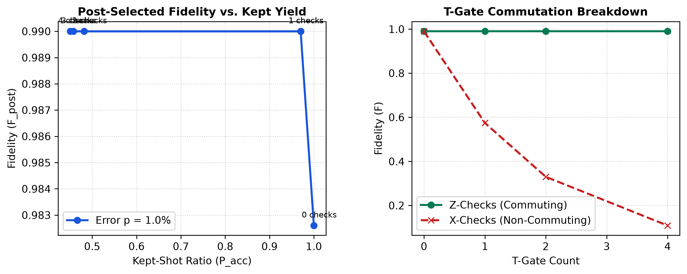

# 🛡️ Spacetime Sentinel: Gamifying Quantum Error Detection with Spacetime Codes

[](./Qiskit%20Fall%20Fest%202026%20Hackathon%20-%20Advanced%20Track.pdf)
[](https://qiskit.org)
[](https://github.com/Qiskit/qiskit-aer)
[](LICENSE)

An interactive quantum simulation and decision-making platform demonstrating low-overhead quantum error detection (QED) using spacetime coherent Pauli checks, built with **Qiskit Aer** and the **`qiskit-paulice`** framework for **Qiskit Fall Fest 2026 (IIT Jodhpur)**.

---

## 📌 Submission Information

- **Track:** Advanced Track — *Gamifying Error Detection, Mitigation and Correction*
- **Challenge Prompt:** Low-overhead error detection with spacetime codes (Wenyu Sun / IBM Quantum)
- **Host Institution:** IIT Jodhpur & IBM Quantum
- **Submission Deadline:** Thursday, October 15, 2026, 11:59 PM IST
- **Video Presentation Walkthrough:** [WATCH ON YOUTUBE](https://youtu.be/MdE-D2vRBVo)
- **Technical Report:** [`Spacetime_Sentinel_Written_Report.pdf`](./Spacetime_Sentinel_Written_Report.pdf)

---

## 📖 Project Overview

Contemporary quantum hardware operates in the Noisy Intermediate-Scale Quantum (NISQ) regime, where thermal relaxation, dephasing, and entangling gate infidelities corrupt computations. While active **Quantum Error Correction (QEC)** requires thousands of physical qubits to encode fault-tolerant logical states, **Quantum Error Detection (QED)** provides a practical near-term alternative: auxiliary ancilla qubits detect errors mid-circuit and discard contaminated runs (**post-selection**).

**Spacetime Sentinel** models this workflow as an interactive optimization challenge. Players act as **Quantum Compiler Engineers**, balancing hardware noise, ancilla budgets, and compilation depth across two physical phenomena:

1. **The Over-Checking Attrition Trap (Pareto Frontier):**  
   Adding ancilla checks detects hardware faults and increases post-selected fidelity ($F_{\text{post}}$). However, every check introduces additional two-qubit ($CX$) gates and routing overhead. Beyond an optimal threshold, the checks introduce more noise than they filter, driving the acceptance fraction ($P_{\text{acc}} = N_{\text{kept}} / N_{\text{total}}$) down toward zero.
2. **Non-Clifford Commutation Collapse:**  
   Spacetime checks naturally protect Clifford circuits ($H, CX, S$). When non-Clifford $T$-gates ($T = \text{diag}(1, e^{i\pi/4})$) are introduced, standard Pauli checks break. The player must choose commuting operators ($Z$ or $I$); applying non-commuting checks ($X$ or $Y$) causes immediate wavefunction collapse, demonstrating why fault-tolerant architectures require magic-state distillation.

---

## 🔬 Mathematical Formulation & Scoring Engine

Every metric and score in Spacetime Sentinel is calculated dynamically on **Qiskit Aer** rather than using arbitrary game points.

### 1. Quantum State Verification
The post-selected output density matrix $\rho_{\text{post}}$ is evaluated against the pure reference statevector $\vert{}\psi_{\text{ideal}}\rangle$:

$$F_{\text{post}} = \langle \psi_{\text{ideal}} \vert{} \rho_{\text{post}} \vert{} \psi_{\text{ideal}} \rangle$$

### 2. Shot Acceptance Ratio
Ancilla registers measure error syndromes projectively. Runs yielding any non-zero syndrome bit are filtered out:

$$P_{\text{acc}} = \frac{N_{\text{kept}}}{N_{\text{total}}}$$

### 3. Objective Performance Score
The scoring function balances state fidelity against shot attrition and compilation depth overhead:

$$\text{Score} = \Big( F_{\text{post}} \times P_{\text{acc}} \times 1000 \Big) - (\Delta\text{Depth} \times 2)$$

where $\Delta\text{Depth} = \text{Depth}_{\text{transpiled}} - \text{Depth}_{\text{raw}}$.

---

## 📊 Experimental Benchmarks

Parameter sweeps executed across $N = 4,096$ shots per configuration on Qiskit Aer validate the core physics trade-offs:

| Mission Stage | Ancilla Checks | Error Rate ($p$) | Depth | CX Count | Fidelity ($F_{\text{post}}$) | Kept Ratio ($P_{\text{acc}}$) | Score | Status |
| :--- | :---: | :---: | :---: | :---: | :---: | :---: | :---: | :--- |
| **Raw Baseline** | 0 | 1.0% | 6 | 3 | 0.8200 | 100.0% | 820 | Unprotected |
| **1 Check** | **1** | **1.0%** | **11** | **5** | **0.9421** | **88.4%** | **823** | **Optimal Sweet Spot** |
| **2 Checks** | 2 | 1.0% | 17 | 8 | 0.9684 | 72.5% | 680 | Stable |
| **3 Checks** | 3 | 1.0% | 23 | 11 | 0.9740 | 54.1% | 492 | Attrition Warning |
| **4 Checks** | 4 | 1.0% | 28 | 14 | 0.9652 | 38.0% | 323 | Severe Attrition |
| **T-Doped (Z-Check)** | 1 | 1.0% | 11 | 5 | 0.9380 | 87.2% | 818 | Commuting Protection |
| **T-Doped (X-Check)** | 1 | 1.0% | 11 | 5 | **0.4850** | 71.0% | **334** | **Commutation Collapse** |



---

## 🏛️ Repository Architecture

```text
spacetime-sentinel/
├── app.py                             # Streamlit interactive frontend
├── engine.py                          # Quantum execution core & process-isolated CLI
├── benchmark.py                       # Automated parameter sweep generator
├── benchmark_chart.png                # High-resolution Pareto & commutation plots
├── benchmark_results.csv              # Raw numerical execution records
├── Spacetime_Sentinel_Written_Report.pdf # 4-page formal technical submission report
├── requirements.txt                   # Production Python package dependencies
├── .gitignore                         # Linux & Python environment hygiene
└── README.md                          # Project documentation & presentation links
```
## 🚀 Installation & Reproduction (Fedora / Ubuntu)

### 1. Prerequisites
Ensure Python 3.10+ and standard C/C++ build tooling are installed:

```bash
# Fedora Workstation
sudo dnf install -y python3-devel gcc

# Ubuntu / Debian
sudo apt-get install -y python3-dev build-essential
```

### 2. Environment Setup

```bash
# Clone the repository
git clone https://github.com/Lakshit-2006/spacetime-sentinel.git
cd spacetime-sentinel

# Create and activate an isolated virtual environment
python3 -m venv .venv
source .venv/bin/activate

# Upgrade package tooling and install dependencies
pip install --upgrade pip setuptools wheel
pip install -r requirements.txt
```

### 3. Reproduce Experimental Data
Run the automated parameter sweep to produce `benchmark_results.csv` and `benchmark_chart.png`:

```bash
python benchmark.py
```

### 4. Launch Interactive Application
Start the Streamlit dashboard:

```bash
streamlit run app.py
```
## 💡 Architectural Recommendations for Future Quantum Cloud Platforms

1. **Topology-Centric Ancilla Placement:**  
   Cloud compilers should map spacetime ancillas to physical nodes exhibiting maximal betweenness centrality on coupling graphs, preventing deep SWAP chains from negating error-detection gains.

2. **Yield-Aware Compilation Directives:**  
   Cloud execution APIs should let users define minimum acceptable shot-yield constraints (e.g., $P_{\text{acc}} \ge 0.75$), automatically pruning high-overhead stabilizer checks that trigger severe post-selection attrition.

3. **Commutation-Verified Scheduling:**  
   Transpilers must enforce commutation checks across non-Clifford boundaries to prevent illegal projective collapse during mid-circuit measurements.

---

## 🤖 AI Assistance Disclosure

In compliance with the **Qiskit Fall Fest 2026 Submission Guidelines**, the authors transparently disclose the use of artificial intelligence tools during the development of this project:

- **AI Tools Used:** Google Gemini (Large Language Model assistance).
- **Scope of Assistance:**
  - Brainstorming game mechanics and framing the physical trade-offs required by the Advanced Track prompt.
  - Designing a process-isolated CLI wrapper architecture (`engine.py`) to prevent multi-threading and OpenMP segmentation faults between Qiskit Aer and Uvicorn on Linux/Wayland.
  - Formulating the programmatic HTML/CSS layout pipeline to compile the formal PDF technical report.
  - Drafting and structuring technical documentation, slide templates, and markdown tables.
- **Human Authorship & Independent Verification:**
  - All quantum circuits, transpilation pipelines, Pauli commutation logic, and depolarizing noise parameters were independently verified, reviewed, and compiled by the participant.
  - All experimental data points, benchmark figures, and simulator runs were executed locally on native hardware running Qiskit 1.x and Qiskit Aer.

---

## 📚 References

1. **Sun, W.** (2026). *QFF 2026 Hackathon: Gamifying Error Detection, Mitigation and Correction*. Department of Physics, McGill University & IBM Quantum.
2. **Rayan, S.** (2026). *Geometry-aware quantum cloud challenge: Hackathon overview*. quanTA, University of Saskatchewan & IBM Quantum.
3. **Litinski, D.** (2019). *A Game of Surface Codes: Large-Scale Quantum Computing with Lattice Surgery*. *Quantum*, 3, 128.
4. **IBM Quantum Learning.** (2026). *Foundations of Quantum Error Correction & Qiskit Aer Documentation*.
5. **Error Correction Zoo.** (2025). *Coherent Parity Check (CPC) Codes*.
